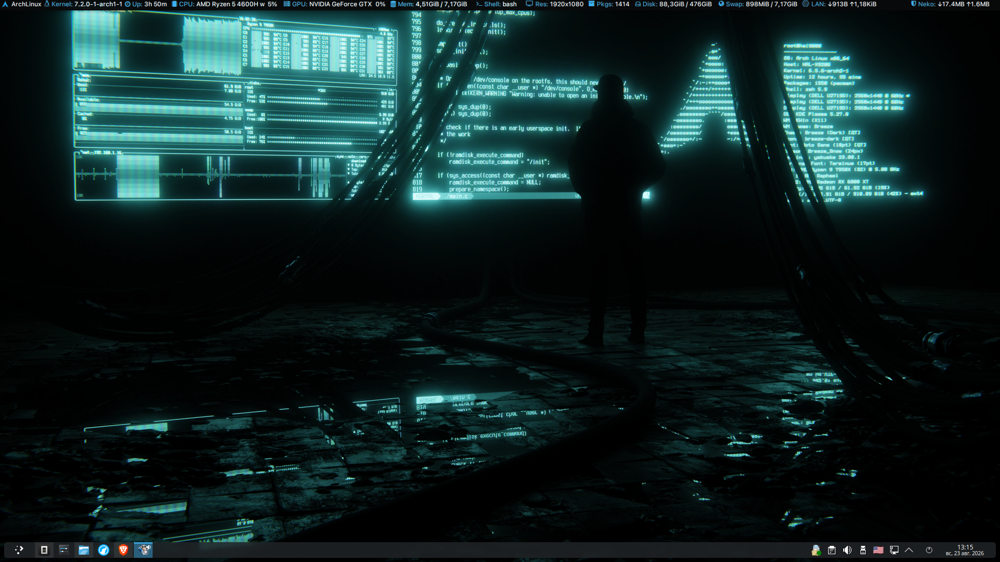

# conky-top

A two-strip Conky top bar for KDE Plasma on X11 (tested with Conky 1.24).
The first strip is a compact system overview. The second strip adds CPU,
memory, disk and swap details, aligned to the same column grid.



## Files

| File | Purpose |
| --- | --- |
| `topbar.conf` | Main top strip, kept in its original `dock` + `above` form. |
| `topbar2.conf` | Second strip: a transparent window drawn **under** normal application windows. |
| `kernel.lua` | Turns the local kernel release into the short `arch1-1` label. |
| `proxy_traffic.sh` | Monthly traffic counter for the active NekoBox profile via the Clash API. |
| `swap_procs.sh` | Finds the 10 processes that use the most swap (`VmSwap` from `/proc`). |
| `img/` | Icons used by the configs. |

## Installation

The configs use absolute paths under `/home/topsh/.config/conky`. Adjust them
if your username differs.

```bash
mkdir -p ~/.config/conky
cp topbar.conf topbar2.conf kernel.lua proxy_traffic.sh swap_procs.sh ~/.config/conky/
cp -r img ~/.config/conky/
chmod +x ~/.config/conky/proxy_traffic.sh ~/.config/conky/swap_procs.sh
```

Both configs must run as **two separate Conky processes**. Passing two `-c`
options to a single process does not work: the text of the last config replaces
the text of the first one. A working autostart script looks like this:

```bash
#!/usr/bin/env bash
set -u
export DISPLAY="${DISPLAY:-:0}"

# Wait for the X display to become usable.
for _ in {1..30}; do
  xdotool getdisplaygeometry >/dev/null 2>&1 && break
  sleep 1
done

# Replace any Conky instance left over from the previous session.
pkill -x conky 2>/dev/null || true
sleep 1

conky -c "$HOME/.config/conky/topbar.conf" &
sleep 1
conky -c "$HOME/.config/conky/topbar2.conf" &
wait
```

## Second strip details

`topbar2.conf` reuses the `${goto N}` positions of the main config, so every
module starts at the same X coordinate as the corresponding main module:

| Column | Position | Content |
| --- | --- | --- |
| 1-3 | 22, 80, 240 | Reserved (blue dot placeholders). |
| 4 | 330 | Top 10 CPU processes (`${top name N}` / `${top cpu N}`). |
| 5 | 545 | Reserved. |
| 6 | 750 | Top 10 memory processes (`${top_mem name N}` / `${top_mem mem N}`). |
| 7-9 | 915, 1010, 1130 | Reserved. |
| 10 | 1220 | Every mounted filesystem with its free space (`${fs_free MOUNTPOINT}`), plus the external disks `sda`/`sdb` and all their partitions (unmounted ones show their size from `lsblk`). |
| 11 | 1380 | Top 10 processes using the most swap. `swap_procs.sh` scans `/proc/*/status` for `VmSwap` and caches the ranked list in `swap_procs.state`. |
| 12-13 | 1540, 1750 | Reserved. |

### Window layer and transparency

The main strip stays in its original `dock` + `above` form. The second strip
uses `own_window_type = 'normal'` with the `below` hint, so application windows
are drawn over it. Transparency comes from `own_window_colour = '#00000000'`
(alpha in `#AARRGGBB`); the deprecated `own_window_transparent` setting makes
the window opaque with this window type.

KWin places `below` windows at the top of the workarea (y=40), so a window rule
for `WM_CLASS=conky2` forces the position to `1920,20`, directly below the main
strip. Add this to `~/.config/kwinrulesrc` (use a unique UUID):

```ini
[<uuid>]
Description=Place conky2 directly below the main strip
ignoregeometry=true
ignoregeometryrule=3
position=1920,20
positionrule=3
wmclass=conky2
wmclassmatch=1
```

Remember to add the UUID to the `rules=` list and increment `count=` in the
`[General]` section, then reload KWin rules:

```bash
qdbus6 org.kde.KWin /KWin reconfigure
```

## License / notes

Archive with icons, images and scripts:
[Archive.tar.gz](https://github.com/user-attachments/files/32159270/Archive.tar.gz)
